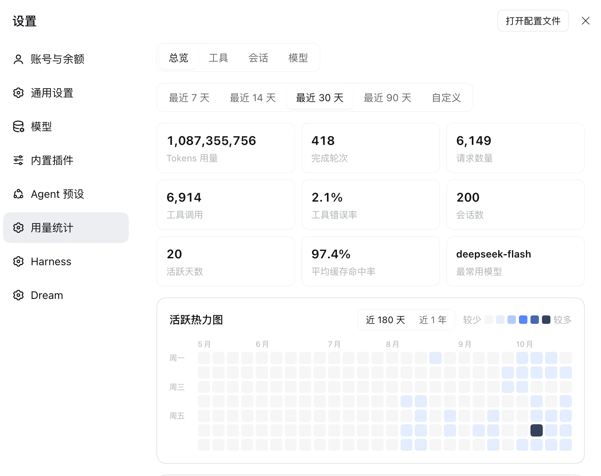
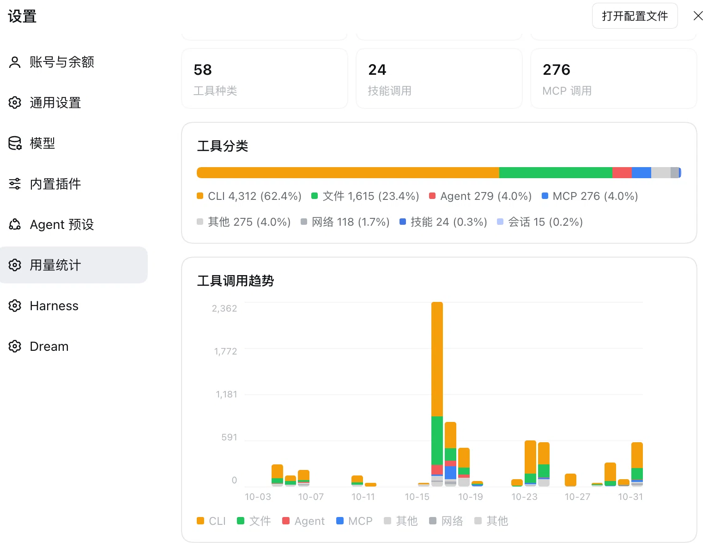
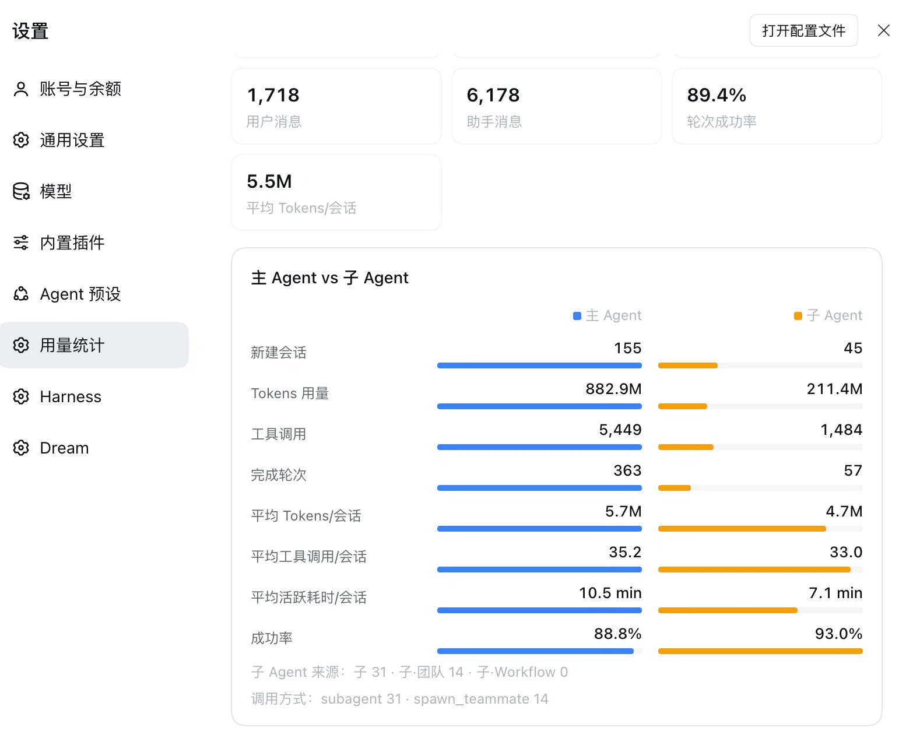
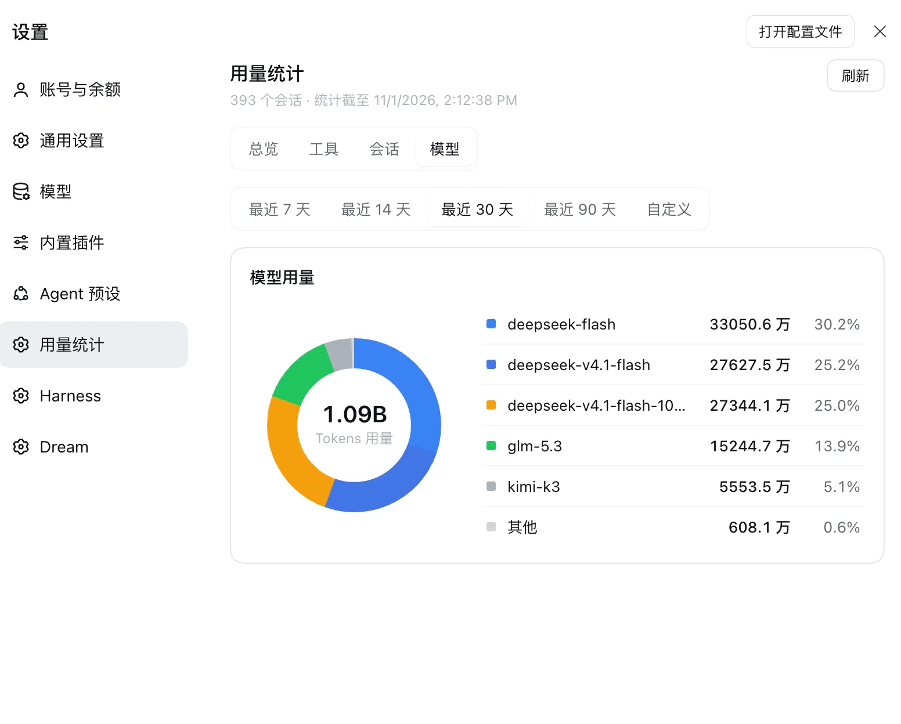

# dsh-token-usage

DeepSeek Harness（DSH）用量统计插件：Token、工具调用、会话指标，以及主 Agent / 子 Agent 对比

挂载位置：设置 → 用量统计

## 功能

### 总览

- 指标卡：Tokens、完成轮次、请求数、工具调用、工具错误率、会话数、活跃天数、缓存命中率、最常用模型
- 活跃热力图：近 180 天 / 近 1 年
- 按天 Token 趋势：top 5 模型堆叠柱 + 缓存命中率折线



### 工具

- 分类占比：MCP / 技能 / CLI / 文件 / 网络 / Agent / 会话 / 其他
- 每日工具调用趋势
- Top 20 工具表：调用数、错误率、平均耗时、占比
- 技能排名、MCP 服务排名



### 会话

- 主 Agent vs 子 Agent 对比卡：新建会话、Tokens、工具调用、完成轮次、平均用量、平均活跃耗时、成功率
- 每日主 / 子对比：Tokens 与工具调用切换
- 会话明细：全部 / 主 / 子 筛选，主 / 子 / 子·团队 / 子·Workflow 类型徽标
- 轮次结果、工作区分布、会话排序



### 模型

- 模型占比环图
- 模型明细与占比



## 安装

DSH 0.1.0-rc 系列（桌面版或 web），侧边栏「插件」→「添加插件」，「包名或地址」输入：

- GitHub 仓库地址：`https://github.com/felixzhang-glitch/dsh-token-usage`
- 本地插件目录：仓库克隆的绝对路径（如 `/Users/name/dsh-token-usage`，本机开发用）

或 CLI：

```bash
dsh plugin --profile <profile> add https://github.com/felixzhang-glitch/dsh-token-usage
dsh plugin --profile <profile> add /Users/name/dsh-token-usage
```

- 官方组合包通道：pnpm 装入 profile + 登记 `dsh.profile.bundles`，包内 `cordis.patch.yml` 自动挂载，无需手改 profile 文件
- 安装失败自动恢复 manifest 与 lockfile
- 装完重启 DSH 生效（desktop profile 无 live 重载）
- 本地目录通道落 `link:` 活链接：仓库改码后重启即生效，无需卸载重装
- GitHub 通道是远端快照：更新需卸载重装
- 本插件不发布 npm：npm 上 `dsh-token-usage` 是第三方同名包（Tastelessor/dsh-usage-stats，带计价）

## 使用

- 设置页进入「用量统计」
- 顶部切换 总览 / 工具 / 会话 / 模型
- 时间范围 7 / 14 / 30 / 90 天或自定义，四个页签共享
- 刷新按钮强制重建缓存，5 秒内重复点击复用上次结果
- 会话页明细支持排序与 全部 / 主 / 子 筛选

## 统计口径

| 指标 | 口径 |
| --- | --- |
| Tokens / 请求 | `assistant/message.data.usage`，按日、按模型、按天×模型聚合 |
| 工具调用 | `tool/call` 计调用，`tool/result` 计错误与耗时；按 callId 配对，归属调用当天 |
| 工具分类 | MCP / 技能 / CLI / 文件 / 网络 / Agent / 会话 / 其他；技能按 `skill:<name>` 单独统计 |
| 会话 | session header 的创建时间、工作目录、origin、delegationDepth；轮次、步数、消息、轮次结果 |
| 主 / 子 Agent | `origin === "subagent"` 或 `delegationDepth > 0` 为子；seeded fork 归主会话 |
| 子 Agent 类型 | `team/member.member.id` 为团队，`tool-workflow/agent-start.childId` 为 Workflow，其余为通用 |
| 时间归属 | Tokens / 工具 / 轮次按事件发生日；新建会话按 header.createdAt |
| fork 去重 | `header.seedLength` 或 `readSession.inheritedEventCount` 跳过继承的 seed 事件 |

> 只输出聚合值与元数据，不输出消息正文、工具参数原文或工具结果文本；不统计金额 / 成本

## 验证与排障

```bash
node --check lib/index.js && node --check lib/client.js
```

- 安装失败 → 插件页报错详情；诊断日志在 `~/.dsh/profiles/<profile>/.plugin-manager/logs`
- 设置页无「用量统计」→ 插件页确认该包已启用，再浏览器硬刷新（client 半）/ 重启 DSH（host 半）
- 条目出现但一直加载 → `/token-usage/stats` 返回 500 时看响应 `error` 字段
- 数据为空 → 确认有带 usage 的模型请求或工具调用；fork 继承历史按 seed 边界去重

## 结构

```text
lib/
  index.js         # host 半：聚合 token / 工具 / 会话 / 主次拆分，注册 GET /token-usage/stats
  client.js        # client 半：ModuleLoader 包装的浏览器 bundle，四页签注入 settings.section
cordis.patch.yml   # 组合包挂载行（dsh.bundle.patch 声明）
package.json       # exports + dsh.bundle + dsh.client + peerDependencies + files 白名单
docs/              # 设计、架构、需求、维护指南与参考资料
```

## 维护

- 依赖契约：`sessionQuery.listSessions/readSession`、`webServer.register`、`settings.section` 槽位、`--dsw-*` token、ModuleLoader 包装格式
- 验证版本：DSH 0.1.7-rc.2（桌面版）/ 0.1.6-alpha.2（web）
- 跨版本升级后先跑本地验证再实机确认，见 `docs/plugin-guide.md`
- 当前版本：`0.5.0`

## 文档

| 路径 | 内容 |
| --- | --- |
| `AGENTS.md` | 代码地图与核心指令 |
| `docs/design.md` / `docs/architecture.md` | 设计与架构 |
| `docs/requirements.md` | 需求迭代记录 |
| `docs/plugin-guide.md` | 插件开发·维护·部署指南 |
| `docs/reference/` | DSH 插件规范、plugin-manager 通道等参考资料 |

插件市场见 [github.com/topics/dsh-plugin](https://github.com/topics/dsh-plugin)
