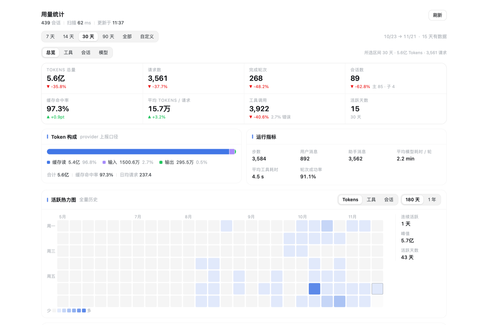
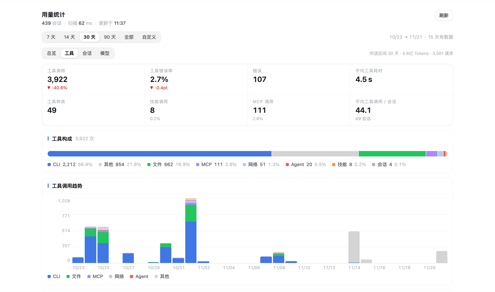
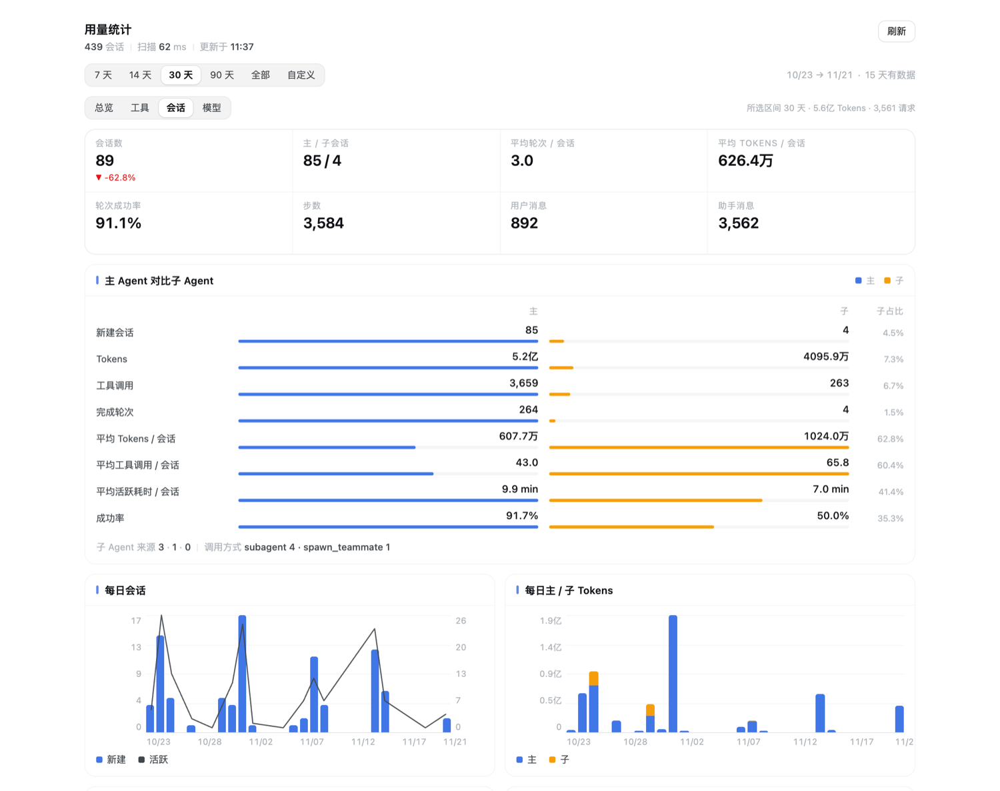
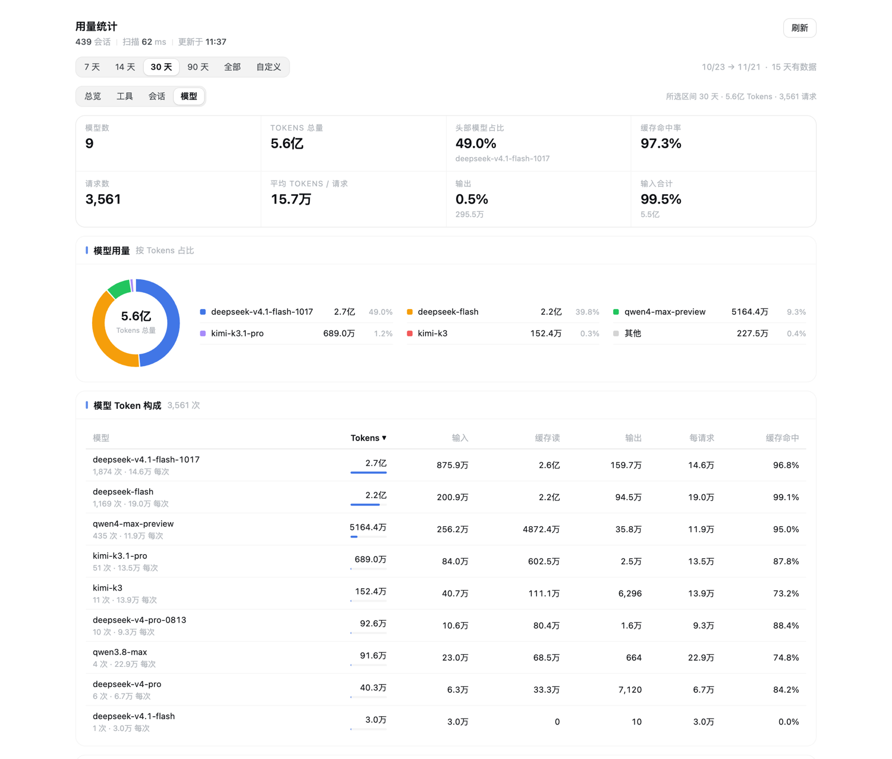

# dsh-token-usage

DeepSeek Harness 的用量统计插件：Token、工具调用、会话指标，以及主 Agent / 子 Agent 对比

安装位置：设置 → 用量统计



## 特性

### 总览

- 8 格指标条：Tokens、请求、轮次、会话、缓存命中率、平均 Tokens/请求、工具调用、活跃天数，每格带环比
- Token 构成（缓存读 / 输入 / 输出）、活跃热力图（Tokens / 工具 / 会话 × 180 天 / 1 年）、模型日趋势
- 每日明细表，可排序，合计行固定可见

### 工具

- 分类构成、每日调用趋势、Top 工具表（搜索 / 排序 / 占比 / 错误率 / 耗时）
- 技能调用与 MCP 服务明细



### 会话

- 主 Agent 对比子 Agent：会话、Tokens、工具调用、轮次、平均用量、成功率，末列子占比
- 每日会话、每日主 / 子 Tokens、轮次结果、工作区
- 会话明细：搜索 + 全部 / 主 / 子筛选 + 多列排序



### 模型

- 环图 + 模型清单、Token 构成表（输入 / 缓存读 / 输出 / 每请求 / 缓存命中）
- 模型日趋势



## 读数口径

- 体量一位小数，自动进位：`4.5亿`、`6109.2万`，不出现 `10000.0万`；悬停看精确值
- 环比对比前一等长窗口；无基期显示「新增」/「—」
- 只输出聚合值与元数据，不输出消息正文和工具参数

## 安装

桌面版或 web：侧边栏「插件」→「添加插件」，填 GitHub 地址或本地目录绝对路径

```bash
dsh plugin --profile <profile> add https://github.com/felixzhang-glitch/dsh-token-usage
dsh plugin --profile <profile> add /Users/name/dsh-token-usage   # 本地开发，link: 挂载
```

装完重启 DSH 生效。GitHub 通道是快照，更新需重装；本地目录通道改码重启即生效

## 使用

- 时间范围 7 / 14 / 30 / 90 天、全部或自定义，四页签共享
- 刷新按钮强制重建缓存，5 秒内重复点击复用上次结果
- 表格点表头排序，图表悬停看当日明细

## 统计口径

| 指标 | 口径 |
| --- | --- |
| Tokens / 请求 | `assistant/message.data.usage`，按日、模型、天×模型聚合 |
| 工具调用 | `tool/call` 计调用，`tool/result` 计错误与耗时，按 callId 配对归属调用当天 |
| 会话 | session header 的创建时间、工作目录、origin、delegationDepth |
| 主 / 子 Agent | `origin === "subagent"` 或 `delegationDepth > 0` 为子，seeded fork 归主 |
| fork 去重 | `header.seedLength` 或 `readSession.inheritedEventCount` 跳过继承事件 |

## 结构

```text
lib/index.js      # host：聚合 + GET /token-usage/stats（预热 + SWR + 单飞）
lib/client.js     # client：ModuleLoader bundle，四页签注入 settings.section
cordis.patch.yml  # 组合包挂载行
package.json      # exports + dsh.bundle + dsh.client + peers + files 白名单
```

## 文档

| 路径 | 内容 |
| --- | --- |
| `AGENTS.md` | 代码地图与核心指令 |
| `docs/design.md`、`docs/architecture.md` | 设计与架构 |
| `docs/requirements.md` | 需求迭代记录 |
| `docs/plugin-guide.md` | 插件开发·维护·部署 |
| `docs/TEST.md` | 验证方式（含本机 headless 预览） |

当前版本 `0.6.0` · 验证于 DSH 0.1.7-rc.2（桌面版）/ 0.1.6-alpha.2（web）

插件市场见 [github.com/topics/dsh-plugin](https://github.com/topics/dsh-plugin)
